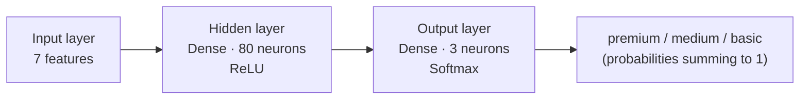

# 00 · Neural Networks from Scratch with TensorFlow.js

> My first neural network: a tiny customer-tier classifier written in plain JavaScript with **TensorFlow.js** on Node.js.
> Part of my AI postgraduate studies — module *Fundamentals*.

The goal of this exercise is not to build a production model. It is to understand, end to end, **what actually happens** when you train a neural network: how real-world data becomes numbers, how a network is assembled layer by layer, what "training" does, and how to read the prediction that comes out.

---

## Table of contents

1. [The problem](#1-the-problem)
2. [From people to numbers: data encoding](#2-from-people-to-numbers-data-encoding)
3. [The labels](#3-the-labels)
4. [Tensors](#4-tensors)
5. [The network architecture](#5-the-network-architecture)
6. [Compiling: optimizer, loss and metrics](#6-compiling-optimizer-loss-and-metrics)
7. [Training](#7-training)
8. [Predicting a new person](#8-predicting-a-new-person)
9. [Reading the result](#9-reading-the-result)
10. [How to run](#10-how-to-run)
11. [Limitations and lessons learned](#11-limitations-and-lessons-learned)
12. [Next steps](#12-next-steps)

---

## 1. The problem

We have three people, each described by **age**, **favorite color** and **city**, and each belongs to a customer tier:

| Name   | Age | Color | City      | Tier        |
|--------|-----|-------|-----------|-------------|
| Erick  | 30  | blue  | São Paulo | **premium** |
| Ana    | 25  | red   | Rio       | **medium**  |
| Carlos | 40  | green | Curitiba  | **basic**   |

**Question:** given a *new* person we have never seen, which tier is the most likely?

This is a **multi-class classification** problem: the input is a set of features, the output is one of three categories.

---

## 2. From people to numbers: data encoding

A neural network only understands numbers. Strings like `"blue"` or `"São Paulo"` mean nothing to it, and raw numbers on very different scales (age ≈ 25–40 vs. flags of 0/1) make training unstable. So every person is turned into a **feature vector of 7 numbers**:

```
[ age_normalized, blue, red, green, São Paulo, Rio, Curitiba ]
```

### 2.1 Numerical feature → min-max normalization

Age is squeezed into the `[0, 1]` range:

```
age_normalized = (age − min_age) / (max_age − min_age)
               = (age − 25) / (40 − 25)
```

| Name   | Age | Normalized |
|--------|-----|------------|
| Ana    | 25  | 0.00       |
| Erick  | 30  | 0.33       |
| Carlos | 40  | 1.00       |

This keeps age on the same scale as the other features, so no single feature dominates the gradient just because its numbers are bigger.

### 2.2 Categorical features → one-hot encoding

Colors and cities have **no natural order** ("green" is not "greater than" "blue"). If we encoded them as `1, 2, 3` the network would learn a fake ordering. Instead each category gets its own column, set to `1` when present and `0` otherwise:

| Color | blue | red | green |
|-------|------|-----|-------|
| blue  | 1    | 0   | 0     |
| red   | 0    | 1   | 0     |
| green | 0    | 0   | 1     |

Same idea for cities (`São Paulo`, `Rio`, `Curitiba`).

### 2.3 The final input dataset

```js
const tensorPessoasNormalizado = [
//   age   blue red green  SP  Rio CWB
    [0.33,  1,   0,   0,    1,  0,   0], // Erick
    [0,     0,   1,   0,    0,  1,   0], // Ana
    [1,     0,   0,   1,    0,  0,   1]  // Carlos
];
```

> In this exercise the encoding is done by hand to make every step visible. In a real project this would be a preprocessing function computed from the training data.

---

## 3. The labels

The outputs (what we want the network to predict) are also one-hot encoded, in the order `[premium, medium, basic]`:

```js
const labelsNomes = ["premium", "medium", "basic"];
const tensorLabels = [
    [1, 0, 0], // premium - Erick
    [0, 1, 0], // medium  - Ana
    [0, 0, 1]  // basic   - Carlos
];
```

Encoding the labels this way lets the network output **one probability per class** instead of a single arbitrary number.

---

## 4. Tensors

A **tensor** is TensorFlow's core data structure: an n-dimensional array of numbers that can be processed efficiently (and in parallel) by the underlying C++ engine.

```js
const inputXs  = tf.tensor2d(tensorPessoasNormalizado); // shape [3, 7] → 3 samples × 7 features
const outputYs = tf.tensor2d(tensorLabels);             // shape [3, 3] → 3 samples × 3 classes
```

By convention `xs` are the inputs and `ys` the expected outputs.

---

## 5. The network architecture

```js
const model = tf.sequential();
model.add(tf.layers.dense({ inputShape: [7], units: 80, activation: 'relu' }));
model.add(tf.layers.dense({ units: 3, activation: 'softmax' }));
```



- **`tf.sequential()`** — a model where layers are stacked one after another; the output of one is the input of the next.
- **Dense layer** — every neuron is connected to every neuron of the previous layer. Each neuron computes `output = activation(Σ(input × weight) + bias)`.
- **Hidden layer (80 neurons, ReLU)** — this is where the network learns combinations of features ("young + São Paulo", "green + Curitiba"…). **ReLU** (`max(0, x)`) adds non-linearity; without it, stacking layers would be mathematically equivalent to a single linear layer.
- **Output layer (3 neurons, Softmax)** — one neuron per class. **Softmax** turns the three raw scores into probabilities between 0 and 1 that **sum to 1**.

### Number of trainable parameters

| Layer  | Weights  | Biases | Total   |
|--------|----------|--------|---------|
| Hidden | 7 × 80   | 80     | 640     |
| Output | 80 × 3   | 3      | 243     |
|        |          |        | **883** |

883 numbers that start random and get adjusted during training. (80 neurons is far more than 3 samples need — it's intentionally generous for experimentation; see [Limitations](#11-limitations-and-lessons-learned).)

---

## 6. Compiling: optimizer, loss and metrics

```js
model.compile({
    optimizer: 'adam',
    loss: 'categoricalCrossentropy',
    metrics: ['accuracy']
});
```

- **Loss — `categoricalCrossentropy`**: measures how far the predicted probability distribution is from the true one-hot label. If the correct class gets probability close to 1, the loss is close to 0; if it gets a low probability, the loss grows quickly. It's the standard loss for multi-class classification with softmax.
- **Optimizer — `adam`**: the algorithm that uses the gradient of the loss to update the 883 weights. Adam adapts the learning rate per parameter and usually converges well without much tuning.
- **Metric — `accuracy`**: the fraction of samples where the class with the highest probability is the correct one. It's for us humans to follow; the network optimizes the *loss*, not the accuracy.

---

## 7. Training

```js
await model.fit(inputXs, outputYs, {
    verbose: 0,
    epochs: 100,
    shuffle: true,
    callbacks: {
        onEpochEnd: (epoch, logs) => {
            console.log(`Epoch ${epoch}: loss = ${logs.loss.toFixed(4)}, accuracy = ${logs.acc.toFixed(4)}`);
        }
    }
});
```

- **Epoch** — one full pass over the whole dataset. We do 100 of them.
- **`shuffle: true`** — the order of the samples is shuffled each epoch so the network doesn't learn anything from the order itself.
- **`onEpochEnd` callback** — logs loss and accuracy after every epoch so we can watch the network learn.

In each epoch the network: **(1)** makes predictions (forward pass), **(2)** computes the loss against the labels, **(3)** computes the gradients via backpropagation, **(4)** lets Adam nudge each weight in the direction that reduces the loss.

Sample run:

```
Epoch 0:  loss = 1.1334, accuracy = 0.3333
Epoch 1:  loss = 1.1164, accuracy = 0.3333
...
Epoch 84: loss = 0.2478, accuracy = 1.0000
...
Epoch 99: loss = 0.1777, accuracy = 1.0000
```

- **Initial loss ≈ 1.1** — that's `−ln(1/3) ≈ 1.0986`, exactly what you'd expect from a network guessing uniformly among 3 classes. Accuracy 33% = random.
- **Loss steadily decreasing** — the weights are being adjusted in the right direction.
- **Accuracy reaching 100%** — the network classifies all three training people correctly.

*(Numbers vary slightly between runs because weights are initialized randomly.)*

---

## 8. Predicting a new person

```js
const person = [0.2, 0, 0, 1, 1, 0, 0];
```

Decoding the vector: **age 0.2** (≈ 28 years: `25 + 0.2 × 15`), **green**, **São Paulo**.

This person is deliberately ambiguous:
- age is between Ana (25) and Erick (30);
- the color **green** matches **Carlos** (basic);
- the city **São Paulo** matches **Erick** (premium).

```js
async function predict(model, person) {
    const inputTensor = tf.tensor2d([person]);       // shape [1, 7] — a batch with one sample
    const prediction = model.predict(inputTensor);   // shape [1, 3]
    const predArray = await prediction.array();
    return predArray[0].map((prob, index) => ({ prob, index }));
}
```

Note `tf.tensor2d([person])`: the model always expects a **batch** of samples, even if the batch contains a single person.

The probabilities are then sorted from highest to lowest and mapped back to their human-readable names.

---

## 9. Reading the result

Two consecutive runs of the same code:

```
Run 1: [ 'basic: 45.xx%',   'premium: 37.xx%', 'medium: 18.xx%' ]
Run 2: [ 'premium: 42.22%', 'basic: 39.88%',   'medium: 17.90%' ]
```

The network is **not certain** — and that's the interesting part. It saw conflicting signals (green → basic, São Paulo → premium) and expressed this as a split probability between *basic* and *premium*, with *medium* clearly last.

Notice that **the winner flips between runs**. Weights start random and the data has only 3 examples, so there isn't enough evidence to settle the tie consistently. That's a direct, visible symptom of the "tiny dataset" problem discussed below. Softmax outputs are a distribution, not a yes/no answer, and that uncertainty is information in itself.

---

## 10. How to run

**Requirements**
- **Node.js 22 (LTS)** — pinned in [`mise.toml`](./mise.toml).
  ⚠️ `@tensorflow/tfjs-node@4.22` does **not** work on Node ≥ 23: it relies on `util.isNullOrUndefined`, which was removed from Node core.

```bash
# with mise (picks up Node 22 automatically)
mise install

npm install
npm start          # node --watch: re-runs on every save
# or
node index.js
```

`@tensorflow/tfjs-node` binds to the native TensorFlow C library, so it runs much faster than the pure-JS/browser build.

---

## 11. Limitations and lessons learned

This is a learning exercise, and being honest about its limits is part of the learning:

- **3 samples is not a dataset.** With 883 parameters and 3 examples, the network can simply *memorize* the answers (100% training accuracy says nothing about generalization). A real model needs hundreds or thousands of examples.
- **No validation/test split.** Without held-out data there's no way to measure how well the model generalizes to unseen people.
- **Manual preprocessing.** Normalization and one-hot encoding were hard-coded. In practice, they are computed from the training data, and the *same* transformation (same min/max, same category order) must be applied at prediction time.
- **Oversized hidden layer.** 80 neurons is plenty for 7 inputs and 3 classes; it's a knob to experiment with.

Key takeaways:

1. **Data representation is half the work.** Normalization and one-hot encoding are what make the problem learnable.
2. **Architecture choices follow the problem:** softmax + categorical cross-entropy for multi-class classification.
3. **The loss curve tells a story:** starting at ≈ `ln(3)` and going down is the network going from guessing to learning.
4. **Predictions are probabilities**, and ambiguous inputs produce honest, ambiguous outputs.

---

## 12. Next steps

- Generate a larger synthetic dataset and split it into train/validation/test.
- Write the preprocessing step (normalization + one-hot) as reusable functions.
- Track `val_loss` to detect overfitting; try early stopping.
- Experiment with hidden layer size, number of layers and epochs.
- Save and reload the trained model (`model.save('file://...')`).

---

## Tech stack

- [TensorFlow.js](https://www.tensorflow.org/js) — `@tensorflow/tfjs-node` 4.22
- Node.js 22 · ES modules
- [mise](https://mise.jdx.dev/) for runtime version management
